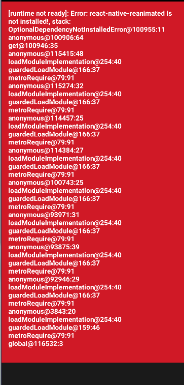

# Rắn Săn Mồi 🐍

Game rắn săn mồi cổ điển viết bằng **React Native + Expo (SDK 57)**. Vuốt hoặc
dùng D-pad để điều khiển, ăn mồi để dài ra, tránh đâm tường và thân mình. Điểm
kỷ lục được lưu lại giữa các phiên chơi.



## Tính năng

- Lưới 20×20, rắn tăng tốc dần theo số mồi ăn được.
- Điều khiển bằng vuốt (swipe) hoặc D-pad; lệnh được nhận ngay khi chạm/kéo,
  không đợi nhấc tay.
- Đệm tối đa 2 lệnh hướng để bấm nhanh không bị mất input.
- Vòng lặp theo **delta-time** nên tốc độ game ổn định, không phụ thuộc tần số
  khung hình của thiết bị.
- Lưu điểm kỷ lục bằng AsyncStorage.
- Tạm dừng / tiếp tục, màn hình chờ và màn hình thua. Tự tạm dừng khi app
  xuống nền.

## Phạm vi (đã chốt)

Bản này **không có âm thanh** và **không có chướng ngại vật**. Đây là quyết định
thiết kế có chủ đích để giữ game tối giản, không phải tính năng còn thiếu. (Các
commit "add sound" / "chướng ngại vật" trong lịch sử git của thư mục cha thuộc
về một project khác — game 2048 — chứ không phải game rắn này.)

## Cài đặt & chạy

```bash
npm install
npm start        # mở Expo dev server
npm run android  # chạy trên Android
npm run ios      # chạy trên iOS
npm run web      # chạy trên trình duyệt
```

## Kiểm thử

Logic lõi (di chuyển, va chạm, sinh mồi trong `src/engine.ts`) và vòng lặp
(nhịp, đệm lệnh, dồn bước trong `src/loop.ts`) đều là hàm thuần, không phụ
thuộc React, nên kiểm thử được bằng Jest:

```bash
npm test
```

## Cấu trúc

| Đường dẫn | Vai trò |
|---|---|
| `App.tsx` | Giao diện: bàn cờ, điểm, D-pad, các overlay. |
| `src/engine.ts` | Lõi logic thuần: `stepSnake`, `spawnFood`, va chạm. |
| `src/loop.ts` | Mô phỏng thuần: nhịp theo điểm, đệm lệnh, `runFrame` theo delta-time. |
| `src/useSnakeGame.ts` | Hook nối mô phỏng với React: rAF, lưu kỷ lục, tự tạm dừng. |
| `src/GameBoard.tsx` | Vẽ bàn cờ; lưới nền tĩnh được memo hoá riêng. |
| `src/constants.ts` | Cấu hình lưới, tốc độ, màu sắc, kiểu dữ liệu. |
| `src/__tests__/` | Test cho lõi game, vòng lặp và tiến độ. |
